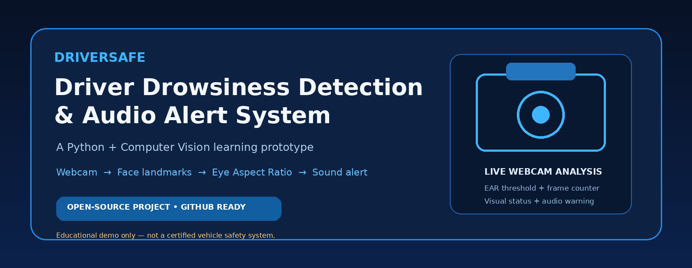
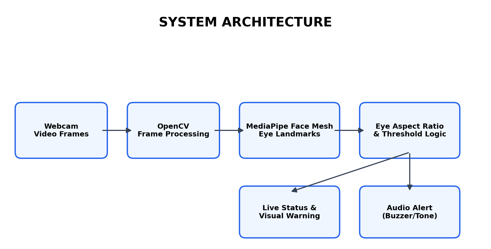
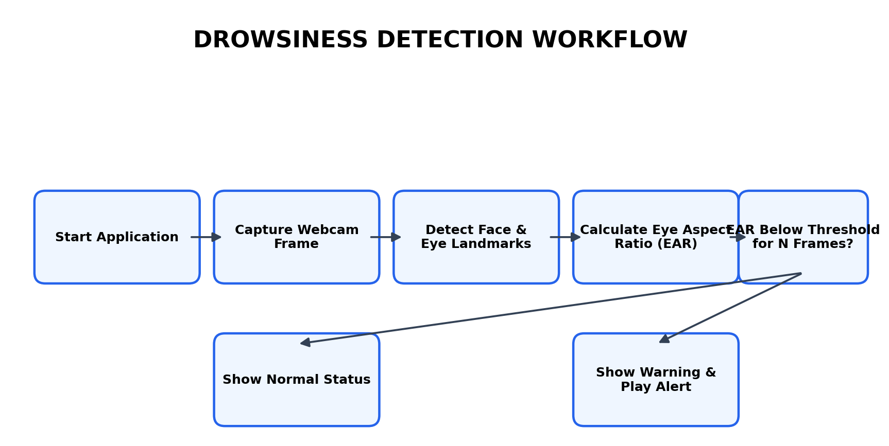

# 🚗 DriverSafe — Driver Drowsiness Detection & Audio Alert System

<p align="center">
  
</p>

<p align="center">
  <b>Stay Alert. Drive Safe.</b><br>
  A Python computer-vision project that monitors eye closure through a webcam and plays an audible warning when a configurable drowsiness threshold is reached.
</p>

<p align="center">
  
  
  
  
  
</p>

## Overview

DriverSafe is an educational, webcam-based prototype for demonstrating a computer-vision approach to driver drowsiness monitoring. It uses **OpenCV** to capture webcam frames, **MediaPipe Face Mesh** to locate facial landmarks, and the **Eye Aspect Ratio (EAR)** to estimate whether the eyes remain closed across a configurable number of consecutive frames. When the threshold is crossed, the application displays a warning and attempts to play an alert sound.

> **Important provenance note:** This repository contains a newly created reference implementation prepared for GitHub. It is not a recovered copy of any previously built, submitted, or deployed project. Replace or extend it with your original implementation if you have one.

> **Safety notice:** This is a learning/demo prototype, not a certified driver-monitoring or vehicle-safety system. It can miss drowsiness or trigger false alarms due to lighting, camera position, glasses, occlusion, face orientation, and individual differences. Never rely on it while driving or use it as a substitute for rest, safe driving practices, or certified safety equipment. Test only in a stationary, controlled environment.

## ✨ Features

- Live webcam frame capture using OpenCV.
- Face and eye landmark detection using MediaPipe Face Mesh.
- Eye Aspect Ratio (EAR) calculation for both eyes.
- Configurable EAR threshold and consecutive-frame trigger.
- On-screen EAR value and status indicator.
- Best-effort audio warning with a cooldown to reduce repeated beeps.
- Command-line options for camera index and sensitivity tuning.
- Modular code with a small unit-test suite.

## 🧰 Technology Stack

| Technology | Role |
|---|---|
| Python | Main programming language |
| OpenCV | Webcam access, frame processing, and display |
| MediaPipe Face Mesh | Facial landmark detection |
| NumPy | Dependency used by the computer-vision stack |
| `winsound` / terminal bell | Best-effort alert sound, depending on operating system |
| Git & GitHub | Version control and project hosting |

## 🧠 How It Works

1. **Capture:** OpenCV reads frames from the selected webcam.
2. **Landmark detection:** MediaPipe Face Mesh identifies facial landmarks.
3. **Eye measurement:** The application calculates the Eye Aspect Ratio (EAR) for the left and right eyes.
4. **Temporal check:** EAR below the configured threshold increments a consecutive-frame counter; an open-eye reading resets it.
5. **Warning:** When the counter reaches the configured limit, the interface displays a drowsiness warning and triggers an audio alert.

<p align="center">
  
</p>

<p align="center">
  
</p>

### Eye Aspect Ratio

EAR compares vertical eye opening with horizontal eye width. A lower value can indicate a closed or nearly closed eye. This prototype uses a simple threshold and consecutive-frame rule; it is not a medical measurement or a validated fatigue classifier.

## 📦 Project Structure

```text
Driver-Drowsiness-Detection/
├── assets/
│   ├── project-showcase.png
│   ├── system-architecture.png
│   └── detection-workflow.png
├── docs/
│   ├── PROJECT_OVERVIEW.md
│   ├── USER_BENEFITS.md
│   └── FUTURE_ENHANCEMENTS.md
├── src/
│   ├── __init__.py
│   ├── alerts.py
│   ├── app.py
│   └── detector.py
├── tests/
│   └── test_detector.py
├── .env.example
├── .gitignore
├── requirements.txt
├── CONTRIBUTING.md
├── LICENSE
└── README.md
```

## ⚙️ Installation & Setup

### Prerequisites

- Python 3.10 or 3.11 recommended.
- A working webcam.
- Webcam permission enabled for your terminal or IDE.
- Windows, macOS, or Linux (MediaPipe wheel availability can vary by platform and Python version).

### 1. Clone the repository

```bash
git clone https://github.com/YOUR-USERNAME/Driver-Drowsiness-Detection.git
cd Driver-Drowsiness-Detection
```

### 2. Create and activate a virtual environment

**Windows**
```bash
python -m venv .venv
.venv\Scripts\activate
```

**macOS / Linux**
```bash
python3 -m venv .venv
source .venv/bin/activate
```

### 3. Install dependencies

```bash
python -m pip install --upgrade pip
pip install -r requirements.txt
```

### 4. Run the application

```bash
python src/app.py
```

Press **Q** while the video window is focused to exit.

## 🎛️ Configuration

Tune the threshold and consecutive-frame count for your environment:

```bash
python src/app.py --threshold 0.21 --frames 18
```

Use another camera device:

```bash
python src/app.py --camera 1
```

Disable the mirrored preview:

```bash
python src/app.py --no-mirror
```

The default values are starting points only. Camera resolution, lighting, face position, and hardware can affect the observed EAR. There is no universal threshold that works reliably for every person and camera.

## 🧪 Run Tests

From the repository root:

```bash
python -m unittest discover -s tests -v
```

The tests cover the EAR helper's basic input behavior; they do not validate real-world drowsiness detection accuracy.

## 🌍 Potential Applications

- Computer-vision learning and demonstration.
- Academic mini-projects and final-year project exploration.
- Prototyping driver-monitoring concepts in a controlled lab.
- Demonstrating real-time video processing and alert workflows.

## 🔐 Privacy

This reference implementation processes webcam frames locally and does not intentionally upload or store video frames. Camera access begins when the application is run. Users should review the code and their operating system's camera permissions before use.

## 🗺️ Future Enhancements

See [`docs/FUTURE_ENHANCEMENTS.md`](docs/FUTURE_ENHANCEMENTS.md) for a detailed roadmap. Potential additions include yawn detection, head-pose estimation, calibration, event logging, configurable alert patterns, and a more robust validation process.

## 🤝 Contributing

Issues, bug reports, and pull requests are welcome. Please read [`CONTRIBUTING.md`](CONTRIBUTING.md) before contributing.

## 👤 Author & Project Attribution

Add your name, portfolio, and contact links here before publishing:

- **Author:** YOUR NAME
- **GitHub:** https://github.com/YOUR-USERNAME
- **Portfolio / LinkedIn:** YOUR PROFILE URL

## 📄 License

Distributed under the MIT License. See [`LICENSE`](LICENSE).

---

<p align="center"><b>DriverSafe — A learning project exploring computer vision for safer journeys.</b></p>
